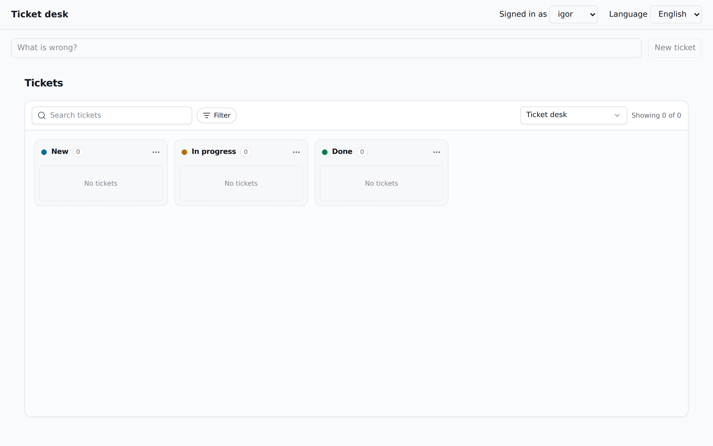
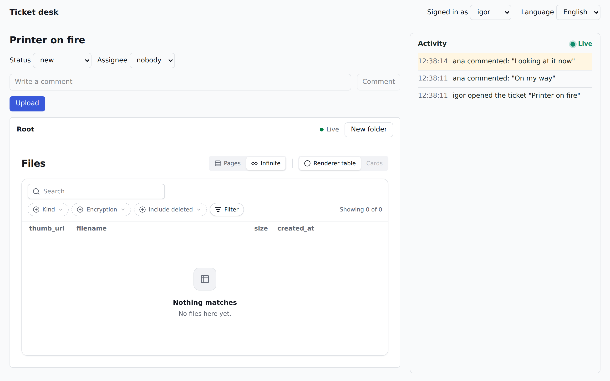
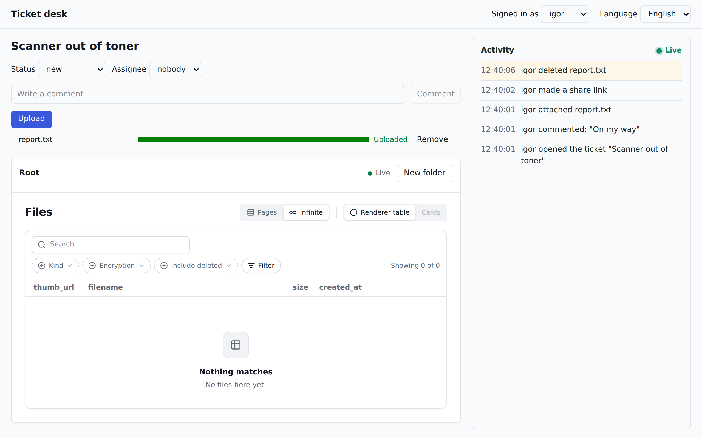

import TutorialFile from "../../../components/TutorialFile.astro";
import TutorialRun from "../../../components/TutorialRun.astro";

[This tutorial in English](/tutorials/ticket-desk/)

Ovaj tutorijal od praznog foldera pravi mali help-desk: kanban tablu sa tiketima, stranicu svakog tiketa sa njegovim fajlovima i feed koji prikazuje sve što se dešava, u trenutku kad se dešava. Program pišete vi; fajlovi i istorija su dva servisa koja pokrećete pored njega.

## vola i memento

**vola** je servis za fajlove koji sami hostujete. Čuva bajtove i njihovu hijerarhiju: otpremanja, sličice, foldere, verzije i linkove za deljenje, a svaki fajl stoji pod nekom instancom vaše aplikacije, recimo `tickets/<id>`.

**memento** je dnevnik aktivnosti koji sami hostujete. Aplikacija mu šalje događaje (`TICKET_COMMENTED`, uradila `ana`, na `tickets/<id>`). Memento ih čuva kao trag koji se ne menja, svaki pretvara u rečenicu na jeziku čitaoca, a nove šalje preko WebSocket-a.

Idu zajedno zato što fajl u pravoj aplikaciji ima vlasnika i istoriju. Vola zna šta su bajtovi i gde stoje. Ne zna zašto su tu, i ne treba da zna. Memento zna ko je šta uradio, a ne drži nijedan bajt. U ovom programu svaki servis radi svoju polovinu, a korak 7 ih spaja sa dve promenljive okruženja, bez koda.

## Šta pravite

Ticket desk, u sedam koraka. Svaki korak je jedan commit u istoriji gotovog programa, a poglavlja ispod prate isti redosled i iste nazive.

| korak | šta dodaje | šta možete posle njega |
|---|---|---|
| 1 | stack | `GET /health` odgovara, a vola i memento rade |
| 2 | ključevi | desk ima tenanta i API ključeve u oba servisa |
| 3 | backend | pravljenje, dodela i pomeranje tiketa preko `curl`-a |
| 4 | događaji | svaka akcija je događaj, sa rečenicom na engleskom i srpskom |
| 5 | UI | tabla, fajlovi i feed u browseru |
| 6 | live | izmena bilo koga se pojavljuje bez ponovnog učitavanja |
| 7 | audit, bez koda | vola sopstvene događaje šalje u isti feed |

Tiketi su jedna [jsudc](https://github.com/digital-cube/jsudc-example) kolekcija, jer jsudc daje kanban tablu bez dodatnog rada. Tutorijal nije o tabli, pa ona zauzima jednu komponentu.

## Šta vam treba

- Docker sa Compose v2. Ceo stack radi u kontejnerima.
- Node 24. Backend pokreće TypeScript direktno, bez build koraka.
- pnpm 11. Ako ga nemate, `corepack enable` daje verziju koju traži `package.json`.

Port 8080 mora da bude slobodan. Ako nije, u koraku 1 postavite `DESK_PORT` u `.env` i svuda ispod koristite taj port u `curl` komandama.

## Kako da čitate kod

Svaki fajl svakog koraka je na ovoj stranici. Fajl koji korak **dodaje** prikazan je ceo, pod svojom putanjom. Iskopirajte ga na tu putanju.

Fajl koji korak **menja** prikazan je kao diff: linije sa `+` su nove, linije sa `-` odlaze, a ostale pokazuju gde je izmena. Izmenite fajl ručno, ili u folderu programa pokrenite `patch -p1`, nalepite blok i pritisnite Ctrl-D.

Testovi i dugački stilovi su sklopljeni, pod linijom „Prikaži". Deo su programa kao i sve ostalo, i provere ispod ih pokreću.

`pnpm-lock.yaml` nije prikazan: njega piše `pnpm install`. Nije ni `README.md`, jer on samo upućuje ovamo.

## Korak 1: stack

Počnite od svega na čemu program radi, uz backend koji samo javlja da je živ. Napravite folder programa i od sada radite u njemu:

`mkdir ticket-desk && cd ticket-desk`

`@vola/*` i `@memento/*` još nisu na npm-u, pa klijentski paketi stižu kao pet tarball fajlova sa ovog sajta. Sami servisi su Docker slike, tako da je ovih pet fajlova sve što uzimate spolja:

<TutorialRun step={1} name="1-vendor" />

### Projekat

`package.json` još ne zavisi ni od jednog servisa, samo od Fastify-ja. `pnpm-workspace.yaml` čini ovaj folder zasebnim projektom i upućuje nazive paketa na `vendor/`. To ništa ne košta dok korak 4 ne zatraži jedan od njih.

<TutorialFile step={1} path="package.json" />
<TutorialFile step={1} path="pnpm-workspace.yaml" />
<TutorialFile step={1} path="tsconfig.json" />
<TutorialFile step={1} path=".gitignore" />
<TutorialFile step={1} path=".env.example" />

Prikaži <code>biome.json</code> (pravila za lint i format)

<TutorialFile step={1} path="biome.json" />

### Backend

Za sada jedna ruta. Kasniji koraci menjaju ovaj fajl, deo po deo.

<TutorialFile step={1} path="src/server/main.ts" />

### Kontejneri

Slika instalira zavisnosti iz lockfile-a i pokreće TypeScript takav kakav je.

<TutorialFile step={1} path="Dockerfile" />
<TutorialFile step={1} path=".dockerignore" />

Jedan PostgreSQL drži po jednu bazu za svaki program, da se ništa ne meša. Bazu programa pravi sama slika, jer je `POSTGRES_USER` imenuje, pa ova skripta pravi preostale dve:

<TutorialFile step={1} path="docker/init-databases.sql" />

Compose fajl je najveći deo ovog koraka. `vola` i `vola-worker` su ista slika: worker pravi sličice iz istog `/data`. Samo `desk` objavljuje port. Browser će do vole i mementa stizati preko njega, na jednom origin-u.

<TutorialFile step={1} path="docker-compose.yaml" />
<TutorialFile step={1} path="Makefile" />

### Provera

`pnpm install` piše lockfile koji slici treba. Prvi `up` preuzima slike i traje nekoliko minuta.

<TutorialRun step={1} name="2-up" />
<TutorialRun step={1} name="3-check" />

Treba da vidite `{"ok":true}` i svih šest servisa u stanju `running`. Nijedan servis još ne zna za desk. To je sledeći korak.

## Korak 2: ključevi

I vola i memento imaju više tenanata, i nijedan vas ne pušta bez ključa. Ovaj korak u svakom pravi tenanta `desk`, preko komandne linije koja je u njihovim slikama, i još četiri ključa:

| u `.env` | ko ga drži | dozvole |
|---|---|---|
| `MEMENTO_SERVER_KEY` | backend | `write`: šalje događaje |
| `VOLA_SERVER_KEY` | backend | `files:read`: čita ime priloženog fajla |
| `MEMENTO_BROWSER_KEY` | browser | `read`: feed |
| `VOLA_BROWSER_KEY` | browser | `files:*`, `folders:*`, `shares:write`: otpremanje ide direktno na volu |

Skriptu možete bezbedno da pokrenete ponovo, jer se ključ koji već postoji u `.env` zadržava. Kasniji koraci se na to oslanjaju: svaki koji od servisa traži nešto novo dodaje ovde par linija, a vi ponovo pokrenete `make setup`.

<TutorialFile step={2} path="scripts/setup.sh" />

Backend dobija ključeve iz okruženja, a Makefile novu metu:

<TutorialFile step={2} path="docker-compose.yaml" />
<TutorialFile step={2} path="Makefile" />

### Provera

<TutorialRun step={2} name="1-setup" />
<TutorialRun step={2} name="2-check" />

Treba da vidite četiri imena ključeva i tenanta u oba servisa. Ovaj program nema prijavu, pa korak 5 browseru daje njegova dva ključa. Prava aplikacija ih daje samo prijavljenim korisnicima.

Ako ikad poželite da počnete iznova, `make clean` briše sve podatke, a s njima i `.env`.

## Korak 3: backend

Sada program ima šta da čuva: tikete, u sopstvenoj bazi. Nijedan servis ne učestvuje u ovom koraku.

### Tiketi kao kolekcija

Tiket je jedan red jsudc kolekcije. `schema.json` kaže šta je tiket, a `view.yaml` kako ga tabla prikazuje: `kanban_options` je cela konfiguracija table. Kolona table je jedan red kolekcije `buckets`, a kartica stoji u koloni koju imenuje njen `status`.

<TutorialFile step={3} path="collections/tickets/schema.json" />
<TutorialFile step={3} path="collections/tickets/view.yaml" />

Kolone i jedina tabla su male kolekcije u memoriji, popunjene iz seed fajlova:

<TutorialFile step={3} path="collections/buckets/schema.json" />
<TutorialFile step={3} path="collections/buckets/seed.json" />
<TutorialFile step={3} path="collections/buckets/source.yaml" />
<TutorialFile step={3} path="collections/buckets/view.yaml" />
<TutorialFile step={3} path="collections/boards/schema.json" />
<TutorialFile step={3} path="collections/boards/seed.json" />
<TutorialFile step={3} path="collections/boards/source.yaml" />
<TutorialFile step={3} path="collections/boards/view.yaml" />

### Rute

`desk.ts` je ono što dele backend i frontend. Spisak korisnika je cela prijava u ovom programu.

<TutorialFile step={3} path="src/shared/desk.ts" />

| ruta | šta radi |
|---|---|
| `POST /tickets` | novi tiket na vrhu prve kolone |
| `GET /tickets/:id` | jedan tiket |
| `PATCH /tickets/:id/status` | pomera ga u drugu kolonu |
| `POST /tickets/:id/assign` | dodeljuje ga nekome |

Svako pisanje traži `X-User-Id`, koji imenuje jednog od korisnika.

<TutorialFile step={3} path="src/server/tickets.ts" />

`buildApp` kao argument prima sve sa čim backend razgovara, da bi testovi mogli to da zamene. `udcPlugin` servira kolekcije na `POST /udc/*`, a to će tabla čitati. `main.ts` povezuje prave stvari: pravi tabelu, učitava kolekcije i pokreće server.

<TutorialFile step={3} path="src/server/app.ts" />
<TutorialFile step={3} path="src/server/main.ts" />

Ostalo je povezivanje: baza za desk, nove zavisnosti i testovi u proveri tipova.

<TutorialFile step={3} path="docker-compose.yaml" />
<TutorialFile step={3} path="package.json" />
<TutorialFile step={3} path="tsconfig.json" />
<TutorialFile step={3} path="vitest.config.ts" />

Testovi pokreću rute nad tiketima u memoriji, pa za njih ništa ne mora da bude podignuto.

Prikaži testove (<code>test/helpers.ts</code>, <code>test/tickets.test.ts</code>)

<TutorialFile step={3} path="test/helpers.ts" />
<TutorialFile step={3} path="test/tickets.test.ts" />

### Provera

<TutorialRun step={3} name="1-test" />
<TutorialRun step={3} name="2-up" />
<TutorialRun step={3} name="3-check" />

Tiket treba da dobijete tri puta, s tim što su se `assignee`, pa `status` promenili. Bez korisnika backend odbija:

<TutorialRun step={3} name="4-refused" />

## Korak 4: događaji

Ovde stupa memento. Sve što se desi tiketu postaje jedan događaj, na instanci `tickets/<id>`, sa korisnikom kao akterom.

| akcija | `event_type` | `payload` |
|---|---|---|
| `POST /tickets` | `TICKET_CREATED` | `title` |
| `POST /tickets/:id/comments` | `TICKET_COMMENTED` | `text` |
| `PATCH /tickets/:id/status`, ili kartica prevučena na tabli | `TICKET_STATUS_CHANGED` | `status`, `previous` |
| `POST /tickets/:id/assign` | `TICKET_ASSIGNED` | `assignee` |
| `POST /tickets/:id/files` | `TICKET_FILE_ATTACHED` | `file_id`, `filename`, `size`, `mime_type` |

### Koji događaj i kako stiže

`events.ts` kaže koji događaj odgovara akciji i ništa drugo ne radi, pa ga je lako testirati.

<TutorialFile step={4} path="src/server/events.ts" />

`memento.ts` ga šalje preko `POST /memento/events`. Izmena je do tada već sačuvana, pa memento koji ne radi košta jedan red u logu, a ne zahtev korisnika.

<TutorialFile step={4} path="src/server/memento.ts" />

### Rute javljaju

Uz to stižu dve nove rute. Komentar nema svoju tabelu: **događaj jeste komentar**, a komentari žive u mementu. Preko `POST /tickets/:id/files` backend saznaje za fajl: browser otprema direktno na volu, pa to ovde javi. Backend od vole traži taj fajl, pa događaj nosi činjenice iz vole, a fajl koji nije na ovom tiketu biva odbijen.

<TutorialFile step={4} path="src/server/tickets.ts" />

Tabla ne koristi ove rute. Ona piše preko UDC rute `POST /udc/mutate`, pa oko te rute stoje dve Fastify kuke, i prevučena kartica daje isti događaj kao ruta za status.

<TutorialFile step={4} path="src/server/drag.ts" />
<TutorialFile step={4} path="src/server/app.ts" />

`main.ts` prosleđuje pravi memento i pravu volu. Ovo je prva upotreba paketa `@vola/client`:

<TutorialFile step={4} path="src/server/main.ts" />
<TutorialFile step={4} path="docker-compose.yaml" />
<TutorialFile step={4} path="package.json" />

### Rečenice

Sirov JSON ne vredi u feedu. Šablon mementu daje rečenicu za tip događaja na jednom jeziku, a `locale` čitaoca bira koja će se prikazati. Po jedan fajl ide na tip događaja i jezik, pa je `TICKET_ASSIGNED.sr.hbs` srpska rečenica za `TICKET_ASSIGNED`:

<TutorialFile step={4} path="templates/TICKET_CREATED.en.hbs" />
<TutorialFile step={4} path="templates/TICKET_CREATED.sr.hbs" />
<TutorialFile step={4} path="templates/TICKET_COMMENTED.en.hbs" />
<TutorialFile step={4} path="templates/TICKET_COMMENTED.sr.hbs" />
<TutorialFile step={4} path="templates/TICKET_STATUS_CHANGED.en.hbs" />
<TutorialFile step={4} path="templates/TICKET_STATUS_CHANGED.sr.hbs" />
<TutorialFile step={4} path="templates/TICKET_ASSIGNED.en.hbs" />
<TutorialFile step={4} path="templates/TICKET_ASSIGNED.sr.hbs" />
<TutorialFile step={4} path="templates/TICKET_FILE_ATTACHED.en.hbs" />
<TutorialFile step={4} path="templates/TICKET_FILE_ATTACHED.sr.hbs" />

Srpske rečenice su namerno u sadašnjem vremenu. Prošlo vreme traži rod aktera, a događaj ima samo `actor_id`.

`make setup` ih predaje mementu:

<TutorialFile step={4} path="scripts/setup.sh" />

Prikaži testove (<code>test/helpers.ts</code>, <code>test/events.test.ts</code>)

<TutorialFile step={4} path="test/helpers.ts" />
<TutorialFile step={4} path="test/events.test.ts" />

### Provera

<TutorialRun step={4} name="1-test" />
<TutorialRun step={4} name="2-setup" />

Otvorite tiket, komentarišite ga kao `ana` i pomerite ga:

<TutorialRun step={4} name="3-act" />

Sada iz mementa pročitajte istoriju tiketa, na oba jezika. Memento još nema svoj port, pa zahtev ide iz njegovog kontejnera; korak 5 otvara put browseru.

<TutorialRun step={4} name="4-read" />

Treba da vidite ista tri događaja dvaput, najnoviji prvi, po jednom na svakom jeziku. Ništa u bazi programa ne beleži komentar, a on je tu.

## Korak 5: UI

U browseru posao rade tri dela, i sva tri su komponente iz biblioteka:

| | komponenta | razgovara sa |
|---|---|---|
| tabla | `<UdcDataView collection="tickets">` sa `@jsudc/react/kanban`: pretraga, kolone, prevlačenje | `/udc/*` na backendu |
| fajlovi | `<VolaFileBrowser>` i `<VolaUploadButton>` iz `@vola/react`, na instanci `tickets/<id>` | volom, direktno, sa `X-User-Id` |
| feed | `useMementoEvents` iz `@memento/react` | mementom, direktno |

### Jedan origin

Backend sada prosleđuje `/vola` i `/memento` ka dva servisa, HTTP i WebSocket, pa browser vidi jedan origin i nijednom servisu ne treba port. `GET /config` stranici daje njena dva ključa, a backend servira izgrađeni frontend.

<TutorialFile step={5} path="src/server/proxy.ts" />
<TutorialFile step={5} path="src/server/app.ts" />
<TutorialFile step={5} path="src/server/main.ts" />

Slika sada gradi i frontend, a projekat dobija zavisnosti i Vite podešavanje:

<TutorialFile step={5} path="Dockerfile" />
<TutorialFile step={5} path="package.json" />
<TutorialFile step={5} path="index.html" />
<TutorialFile step={5} path="vite.config.ts" />
<TutorialFile step={5} path="tsconfig.web.json" />

### Stranica oko njih

`api.ts` su rute backenda kao funkcije. `session.ts` čuva ko je prijavljen. `App.tsx` učitava `/config`, podešava `MementoProvider` i crta zaglavlje sa dva izbora: ko ste i na kom jeziku feed govori.

<TutorialFile step={5} path="src/web/main.tsx" />
<TutorialFile step={5} path="src/web/api.ts" />
<TutorialFile step={5} path="src/web/session.ts" />
<TutorialFile step={5} path="src/web/App.tsx" />

### Tabla

Cela tabla je jedna komponenta: pita backend šta je kolekcija `tickets` i nacrta je. Prevlačenje piše preko `udc/mutate` sa `X-User-Id`, a kuke iz koraka 4 od toga prave događaj.

<TutorialFile step={5} path="src/web/Board.tsx" />
<TutorialFile step={5} path="src/web/BoardPage.tsx" />

### Fajlovi

Browser sam razgovara sa volom, na instanci `tickets/<id>`, sa prijavljenim korisnikom u `userId`. Sličice, folderi, preuzimanje, brisanje i **Share** u meniju fajla dolaze uz `VolaFileBrowser`. Otpremanje ide kroz `VolaUploadButton` jer preko njegovog `onUploaded` backend saznaje za fajl, a to beleži `TICKET_FILE_ATTACHED`.

<TutorialFile step={5} path="src/web/Files.tsx" />

### Feed

Za sada se feed čita jednom, pa ponovo posle svake vaše akcije.

<TutorialFile step={5} path="src/web/Activity.tsx" />
<TutorialFile step={5} path="src/web/TicketPage.tsx" />

Prikaži <code>src/web/desk.css</code>

<TutorialFile step={5} path="src/web/desk.css" />

Prikaži izmene testova

<TutorialFile step={5} path="test/helpers.ts" />
<TutorialFile step={5} path="test/tickets.test.ts" />

### Provera

<TutorialRun step={5} name="1-test" />
<TutorialRun step={5} name="2-up" />
<TutorialRun step={5} name="3-check" />

Otvorite `http://localhost:8080`. Videćete tablu sa tri kolone, a na njoj tikete koje ste u ranijim koracima napravili `curl`-om. Na čistom stack-u (`make clean`, pa `make setup`) tabla je prazna:

Upišite naslov, pritisnite **New ticket** i kliknite na karticu. Na stranici tiketa promenite status, ostavite komentar i otpremite fajl dugmetom iznad liste fajlova. Svaka akcija se pojavljuje u feedu desno, kao rečenica. Izbor **Language** u zaglavlju prebacuje iste događaje na srpski.

Za razvoj sa ponovnim učitavanjem, `pnpm dev` i `pnpm dev:web` pokreću obe polovine van Docker-a.

## Korak 6: live

Na stranici se još ništa ne pomera ako vi to niste pomerili. Ovaj korak to popravlja bez ikakvog novog servera, jer memento već šalje svaki događaj preko svog WebSocket-a, `/memento/ws`.

`useMementoEvents` učitava najnovije događaje, a zatim dobija svaki novi čim se sačuva. `onEvent` iz feeda javlja tabli i stranici tiketa da ponovo pročitaju podatke, pa tok iz mementa postaje jedini signal koji cela stranica prati, a sve što je u koraku 5 dodato zbog ponovnog čitanja odlazi.

<TutorialFile step={6} path="src/web/Activity.tsx" />
<TutorialFile step={6} path="src/web/BoardPage.tsx" />
<TutorialFile step={6} path="src/web/Board.tsx" />
<TutorialFile step={6} path="src/web/Files.tsx" />
<TutorialFile step={6} path="src/web/TicketPage.tsx" />

Postoji jedna pretplata na ceo desk, a `feed.ts` iz nje bira deo jednog tiketa. Filter samo na `tickets/<id>` bio bi kraći, a korak 7 pokazuje zašto bi nešto propustio.

<TutorialFile step={6} path="src/web/feed.ts" />

Prikaži izmene stilova i test

<TutorialFile step={6} path="src/web/desk.css" />
<TutorialFile step={6} path="test/feed.test.ts" />

Fajlovima ovde ne treba nikakva izmena. `VolaFileBrowser` je živ još od koraka 5: sam otvara WebSocket ka volinom [`/udc/subscribe`](/reference/realtime/), pa se fajl koji drugi tab otpremi ili obriše sam pojavi u listi, odnosno nestane iz nje. Stranica sada prati dva toka, svaki iz servisa koji poseduje te podatke.

### Provera

<TutorialRun step={6} name="1-test" />
<TutorialRun step={6} name="2-up" />

Otvorite tiket i stranicu tiketa u browseru:

<TutorialRun step={6} name="3-comment" />

Dok je ta stranica otvorena, komentarišite iz terminala, kao neko drugi. Ne dirajte stranicu.

<TutorialRun step={6} name="4-comment" />

Rečenica se sama pojavljuje na vrhu feeda. **Live** pored naslova kaže da je tok iz mementa povezan, a **Live** iznad fajlova je tok iz vole:

Isto radi između dva taba: u jednom se prijavite kao neko drugi, a radite u drugom.

## Korak 7: audit, bez koda

Do sada feed prikazuje ono što program kaže. Fajl obrisan preko vole nije u njemu, jer program za to nikad ne čuje. Vola to može sama da javi. Njene destruktivne i bezbednosno važne operacije mogu direktno u memento, a za uključivanje su dovoljne dve promenljive okruženja i još jedan ključ.

<TutorialFile step={7} path="docker-compose.yaml" />
<TutorialFile step={7} path="scripts/setup.sh" />
<TutorialFile step={7} path=".env.example" />

**Nijedna linija programa se ne menja.** Novim događajima trebaju samo rečenice, pa dobijaju šablone kao i ostali:

<TutorialFile step={7} path="templates/VOLA_SHARE_CREATED.en.hbs" />
<TutorialFile step={7} path="templates/VOLA_SHARE_CREATED.sr.hbs" />
<TutorialFile step={7} path="templates/VOLA_SHARE_REVOKED.en.hbs" />
<TutorialFile step={7} path="templates/VOLA_SHARE_REVOKED.sr.hbs" />
<TutorialFile step={7} path="templates/VOLA_FILE_DELETED.en.hbs" />
<TutorialFile step={7} path="templates/VOLA_FILE_DELETED.sr.hbs" />

Zbog ovoga postoji `feed.ts` iz koraka 6. Vola ove događaje stavlja na sopstvene instance, `vola_file/<id>` i `vola_share/<id>`, jer ne zna ništa o tiketima. Do tiketa vodi payload: događaj fajla kaže u kojoj je instanci fajl, a događaj deljenja imenuje fajl.

### Ceo tok kao test

Ostatak koraka je jedan test koji prolazi glavni tok na podignutom stack-u, kroz port programa, kao i zahtevi iz browsera.

<TutorialFile step={7} path="Makefile" />
<TutorialFile step={7} path="package.json" />
<TutorialFile step={7} path="tsconfig.json" />
<TutorialFile step={7} path="vitest.e2e.config.ts" />

Prikaži <code>e2e/smoke.test.ts</code>

<TutorialFile step={7} path="e2e/smoke.test.ts" />

### Provera

:::caution[Ovo traži vola sliku sa popravkom]
Vola 1.0.0 šalje polje koje memento odbija, pa se sa tom slikom ovi događaji gube: `docker compose logs vola-worker` javlja `memento answered 422`, a end-to-end test pada. Popravka je stavka „The audit trail reaches memento" u [changelogu vole](/packages/changelog/). Ako je poslednje izdanje još nema, u `.env` postavite `VOLA_IMAGE=ghcr.io/digital-cube/jsvola:edge` pre nego što pokrenete `make setup`.
:::

<TutorialRun step={7} name="1-setup" />
<TutorialRun step={7} name="2-e2e" />
<TutorialRun step={7} name="3-log" />

Test prolazi, a worker nema nijedno odbijanje da prijavi. Sada to pogledajte sami. Otvorite tiket, otpremite fajl i otvorite meni tog fajla: **Share** pa **Create link** pravi `VOLA_SHARE_CREATED`, a **Delete** sa potvrdom pravi `VOLA_FILE_DELETED`. Oba se pojavljuju u feedu pored događaja programa, sa prijavljenim korisnikom kao akterom, jer je browser voli poslao `X-User-Id`.

Završite svime što program ima:

<TutorialRun step={7} name="4-all" />

## Šta dalje

Program namerno mnogo toga izostavlja. Nema pravu prijavu: ko god otvori stranicu dobija ključeve za browser, a `X-User-Id` se prima na reč. Ako memento ne radi, događaj se gubi uz jedan red u logu, jer je sama izmena već sačuvana. Feed čita najnovijih 200 događaja i iz njih bira deo za tiket, što je ovde sasvim dovoljno; veliki desk bi držao tabelu fajl → tiket i pitao po tiketu.

Odavde možete dalje:

- **Enkripcija.** Fajlovi zapečaćeni na disku, svaki posebno: [kako radi](/concepts/encryption/) i [živi primer](/examples/encrypted/).
- **Keyring i PIN.** Ključevi koje samo korisnik može da otključa, sa `VolaPinGate` iz `@vola/react`: [referenca za enkripciju](/reference/crypto/).
- **Deljenje.** Lozinke, rok i ograničenje preuzimanja na linku za deljenje: [živi primer](/examples/share/).
- **Filter DSL.** Upiti nad događajima u mementu po polju, umesto čitanja najnovijih, preko `POST /memento/events/query`: [API mementa](https://github.com/digital-cube/jsmemento/blob/main/docs/API.md).
- **Drugi tenant.** Pokrenite `create-tenant` i `create-key` ponovo, sa drugim imenom, u oba servisa. Ključ vidi svog tenanta i ništa drugo. Jedan memento ključ prima audit cele vola instalacije, sa imenom vola tenanta u `payload.tenant`.

Reference:

| | vola | memento |
|---|---|---|
| HTTP API | [API](/reference/api/) | [API.md](https://github.com/digital-cube/jsmemento/blob/main/docs/API.md) |
| Uživo | [Real-time](/reference/realtime/) | [STREAMING.md](https://github.com/digital-cube/jsmemento/blob/main/docs/STREAMING.md) |
| Komandna linija | [CLI](/reference/cli/) | [CLI.md](https://github.com/digital-cube/jsmemento/blob/main/docs/CLI.md) |
| React | [Packages](/packages/), [Get started with React](/get-started/react/) | [REACT.md](https://github.com/digital-cube/jsmemento/blob/main/docs/REACT.md) |
| Rečenice | | [TEMPLATES.md](https://github.com/digital-cube/jsmemento/blob/main/docs/TEMPLATES.md) |
