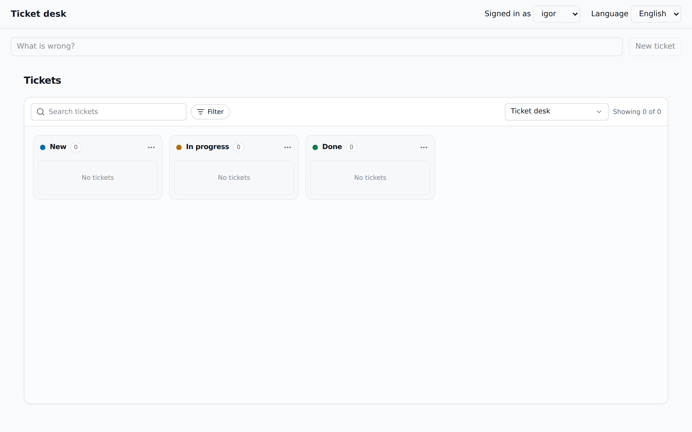
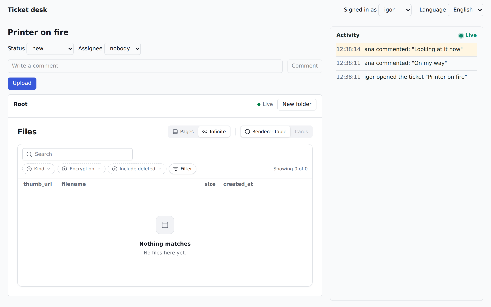
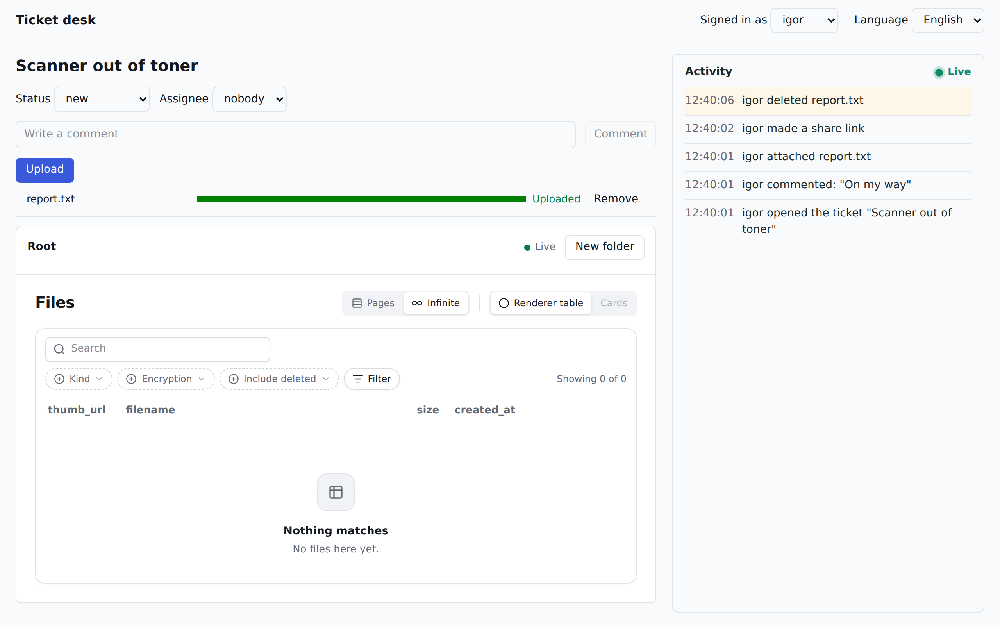

import TutorialFile from "../../../components/TutorialFile.astro";
import TutorialRun from "../../../components/TutorialRun.astro";

[Ovaj tutorijal na srpskom](/tutorials/ticket-desk-sr/)

This tutorial builds a small help desk from an empty folder: a kanban board of tickets, a page for each ticket with its files, and a feed that shows everything that happens as it happens. You write the program; the files and the history are two services you run next to it.

## vola and memento

**vola** is a self-hosted file service. It keeps the bytes and their hierarchy: uploads, thumbnails, folders, versions and share links, each file under an instance of your application such as `tickets/<id>`.

**memento** is a self-hosted activity ledger. Your application pushes events (`TICKET_COMMENTED`, by `ana`, on `tickets/<id>`). memento keeps them as an immutable trail, renders each one into a sentence in the reader's language, and streams new ones over a WebSocket.

They go together because a file in a real application has an owner and a history. vola knows what the bytes are and where they sit. It does not know why they are there, and it should not. memento knows who did what, and it holds no bytes. In this program each service does its own half, and step 7 joins them with two environment variables and no code.

## What you build

The Ticket desk, in seven steps. Each step is one commit in the history of the finished program, and the chapters below use the same order and the same names.

| step | what it adds | what you can do after it |
|---|---|---|
| 1 | the stack | `GET /health` answers, with vola and memento running |
| 2 | the keys | the desk has a tenant and API keys in both services |
| 3 | the backend | create, assign and move tickets with `curl` |
| 4 | the events | every action is an event, with a sentence in English and Serbian |
| 5 | the UI | the board, the files and the feed in a browser |
| 6 | live | a change by anybody shows up without a reload |
| 7 | the audit, without code | vola's own events appear in the same feed |

The tickets are one [jsudc](https://github.com/digital-cube/jsudc-example) collection, because jsudc gives a kanban board out of the box. The board is not what this tutorial is about, so it takes one component.

## What you need

- Docker with Compose v2. The whole stack runs in containers.
- Node 24. The backend runs its TypeScript directly, with no build step.
- pnpm 11. If you do not have it, `corepack enable` gets the version `package.json` asks for.

Port 8080 must be free. If it is not, set `DESK_PORT` in `.env` in step 1 and use your port in every `curl` below.

## How to read the code

Every file of every step is on this page. A file a step **adds** is shown whole, under its path. Copy it to that path.

A file a step **changes** is shown as a diff: `+` lines are new, `-` lines go away, the rest is there to show you where. Edit the file by hand, or run `patch -p1` in the program's folder, paste the block and press Ctrl-D.

Tests and long stylesheets are folded, under a "Show" line. They belong to the program as much as the rest, and the checks below run them.

`pnpm-lock.yaml` is not shown: `pnpm install` writes it. `README.md` is not shown either, because it only points back here.

## Step 1: the stack

Start with everything the program runs on, and a backend that only says it is alive. Make the program's folder and work in it from now on:

`mkdir ticket-desk && cd ticket-desk`

`@vol-a/*` and `@memento/*` are not on npm yet, so the client packages come as five tarballs from this site. The services themselves are Docker images, so these five files are all you take from outside:

<TutorialRun step={1} name="1-vendor" />

### The project

`package.json` has no dependency on either service yet, only Fastify. `pnpm-workspace.yaml` makes this folder its own project and points the package names at `vendor/`. It costs nothing until step 4 asks for one of them.

<TutorialFile step={1} path="package.json" />
<TutorialFile step={1} path="pnpm-workspace.yaml" />
<TutorialFile step={1} path="tsconfig.json" />
<TutorialFile step={1} path=".gitignore" />
<TutorialFile step={1} path=".env.example" />

Show <code>biome.json</code> (lint and format rules)

<TutorialFile step={1} path="biome.json" />

### The backend

One route for now. Later steps replace this file, one piece at a time.

<TutorialFile step={1} path="src/server/main.ts" />

### The containers

The image installs from the lockfile and runs the TypeScript as it is.

<TutorialFile step={1} path="Dockerfile" />
<TutorialFile step={1} path=".dockerignore" />

One PostgreSQL holds one database per program, so nothing mixes. The image makes the desk's own database, because `POSTGRES_USER` names it, so this script makes the other two:

<TutorialFile step={1} path="docker/init-databases.sql" />

The compose file is most of this step. `vola` and `vola-worker` are the same image: the worker makes the thumbnails from the same `/data`. Only `desk` publishes a port. The browser will reach vola and memento through it, on one origin.

<TutorialFile step={1} path="docker-compose.yaml" />
<TutorialFile step={1} path="Makefile" />

### Check it

`pnpm install` writes the lockfile the image needs. The first `up` pulls the images and takes a few minutes.

<TutorialRun step={1} name="2-up" />
<TutorialRun step={1} name="3-check" />

You should see `{"ok":true}` and all six services running. Neither service knows about the desk yet. That is the next step.

## Step 2: the keys

vola and memento are both multi-tenant, and neither lets you in without a key. This step makes a tenant called `desk` in each, through the command lines inside their images, plus four keys:

| in `.env` | who holds it | scopes |
|---|---|---|
| `MEMENTO_SERVER_KEY` | the backend | `write`: it pushes the events |
| `VOLA_SERVER_KEY` | the backend | `files:read`: it reads the name of an attached file |
| `MEMENTO_BROWSER_KEY` | the browser | `read`: the feed |
| `VOLA_BROWSER_KEY` | the browser | `files:*`, `folders:*`, `shares:write`: uploads go straight to vola |

The script is safe to run again, because a key `.env` already has is kept. The later steps rely on that: each one that needs something new from the services adds a few lines here and you run `make setup` again.

<TutorialFile step={2} path="scripts/setup.sh" />

The backend gets the keys from the environment, and the Makefile gets a target:

<TutorialFile step={2} path="docker-compose.yaml" />
<TutorialFile step={2} path="Makefile" />

### Check it

<TutorialRun step={2} name="1-setup" />
<TutorialRun step={2} name="2-check" />

You should see the four key names, and the tenant in both services. There is no login in this program, so step 5 hands the browser its two keys. A real application gives them to signed-in users only.

`make clean` drops all the data and `.env` with it, if you ever want to start over.

## Step 3: the backend

Now the program has something to keep: tickets, in the desk's own database. Neither service is involved in this step.

### The tickets, as a collection

A ticket is one row of a jsudc collection. `schema.json` says what a ticket is, and `view.yaml` says how the board shows it: `kanban_options` is the whole configuration of the board. A column of the board is a row of `buckets`, and a card sits in the column its `status` names.

<TutorialFile step={3} path="collections/tickets/schema.json" />
<TutorialFile step={3} path="collections/tickets/view.yaml" />

The columns and the one board are small collections kept in memory, filled from their seed files:

<TutorialFile step={3} path="collections/buckets/schema.json" />
<TutorialFile step={3} path="collections/buckets/seed.json" />
<TutorialFile step={3} path="collections/buckets/source.yaml" />
<TutorialFile step={3} path="collections/buckets/view.yaml" />
<TutorialFile step={3} path="collections/boards/schema.json" />
<TutorialFile step={3} path="collections/boards/seed.json" />
<TutorialFile step={3} path="collections/boards/source.yaml" />
<TutorialFile step={3} path="collections/boards/view.yaml" />

### The routes

`desk.ts` is what the backend and the frontend share. The list of users is the whole login of this program.

<TutorialFile step={3} path="src/shared/desk.ts" />

| route | what it does |
|---|---|
| `POST /tickets` | a new ticket at the top of the first column |
| `GET /tickets/:id` | one ticket |
| `PATCH /tickets/:id/status` | moves it to another column |
| `POST /tickets/:id/assign` | gives it to somebody |

Every write needs `X-User-Id`, naming one of the users.

<TutorialFile step={3} path="src/server/tickets.ts" />

`buildApp` takes everything the backend talks to as an argument, so the tests can replace it. `udcPlugin` serves the collections at `POST /udc/*`, which is what the board will read. `main.ts` is what connects the real things: it makes the table, loads the collections and starts the server.

<TutorialFile step={3} path="src/server/app.ts" />
<TutorialFile step={3} path="src/server/main.ts" />

The rest is wiring: the database for the desk, the new dependencies, and the tests in the type check.

<TutorialFile step={3} path="docker-compose.yaml" />
<TutorialFile step={3} path="package.json" />
<TutorialFile step={3} path="tsconfig.json" />
<TutorialFile step={3} path="vitest.config.ts" />

The tests run the routes on tickets kept in memory, so nothing has to be up for them.

Show the tests (<code>test/helpers.ts</code>, <code>test/tickets.test.ts</code>)

<TutorialFile step={3} path="test/helpers.ts" />
<TutorialFile step={3} path="test/tickets.test.ts" />

### Check it

<TutorialRun step={3} name="1-test" />
<TutorialRun step={3} name="2-up" />
<TutorialRun step={3} name="3-check" />

You should get the ticket back three times, with `assignee` and then `status` changed. Without a user the backend refuses:

<TutorialRun step={3} name="4-refused" />

## Step 4: the events

This is where memento comes in. Everything that happens to a ticket becomes one event, on the instance `tickets/<id>`, with the user as the actor.

| action | `event_type` | `payload` |
|---|---|---|
| `POST /tickets` | `TICKET_CREATED` | `title` |
| `POST /tickets/:id/comments` | `TICKET_COMMENTED` | `text` |
| `PATCH /tickets/:id/status`, or a card dragged on the board | `TICKET_STATUS_CHANGED` | `status`, `previous` |
| `POST /tickets/:id/assign` | `TICKET_ASSIGNED` | `assignee` |
| `POST /tickets/:id/files` | `TICKET_FILE_ATTACHED` | `file_id`, `filename`, `size`, `mime_type` |

### Which event, and how it gets there

`events.ts` says which event an action is, and does nothing else, so it is easy to test.

<TutorialFile step={4} path="src/server/events.ts" />

`memento.ts` sends one with `POST /memento/events`. The change is already saved by then, so a memento that is down costs a log line and not the user's request.

<TutorialFile step={4} path="src/server/memento.ts" />

### The routes tell

Two new routes arrive with it. A comment has no table of its own: **the event is the comment**, and memento is where comments live. `POST /tickets/:id/files` is how the backend will hear about a file: the browser uploads straight to vola, then says so here. The backend asks vola for that file, so the event carries vola's facts, and a file that is not on this ticket is refused.

<TutorialFile step={4} path="src/server/tickets.ts" />

The board does not use these routes. It writes through UDC's `POST /udc/mutate`, so two Fastify hooks stand around that route, and a dragged card gives the same event as the status route.

<TutorialFile step={4} path="src/server/drag.ts" />
<TutorialFile step={4} path="src/server/app.ts" />

`main.ts` passes in the real memento and the real vola. This is the first use of `@vol-a/client`:

<TutorialFile step={4} path="src/server/main.ts" />
<TutorialFile step={4} path="docker-compose.yaml" />
<TutorialFile step={4} path="package.json" />

### The sentences

Raw JSON is no use in a feed. A template gives memento the sentence for an event type in one language, and the reader's `locale` picks which one to render. There is one file per event type and language, so `TICKET_ASSIGNED.sr.hbs` is the Serbian sentence for `TICKET_ASSIGNED`:

<TutorialFile step={4} path="templates/TICKET_CREATED.en.hbs" />
<TutorialFile step={4} path="templates/TICKET_CREATED.sr.hbs" />
<TutorialFile step={4} path="templates/TICKET_COMMENTED.en.hbs" />
<TutorialFile step={4} path="templates/TICKET_COMMENTED.sr.hbs" />
<TutorialFile step={4} path="templates/TICKET_STATUS_CHANGED.en.hbs" />
<TutorialFile step={4} path="templates/TICKET_STATUS_CHANGED.sr.hbs" />
<TutorialFile step={4} path="templates/TICKET_ASSIGNED.en.hbs" />
<TutorialFile step={4} path="templates/TICKET_ASSIGNED.sr.hbs" />
<TutorialFile step={4} path="templates/TICKET_FILE_ATTACHED.en.hbs" />
<TutorialFile step={4} path="templates/TICKET_FILE_ATTACHED.sr.hbs" />

The Serbian sentences are in the present tense on purpose. The past tense needs the actor's gender, and an event only has `actor_id`.

`make setup` hands them to memento:

<TutorialFile step={4} path="scripts/setup.sh" />

Show the tests (<code>test/helpers.ts</code>, <code>test/events.test.ts</code>)

<TutorialFile step={4} path="test/helpers.ts" />
<TutorialFile step={4} path="test/events.test.ts" />

### Check it

<TutorialRun step={4} name="1-test" />
<TutorialRun step={4} name="2-setup" />

Open a ticket, comment on it as `ana`, and move it:

<TutorialRun step={4} name="3-act" />

Now read the ticket's history back from memento, in both languages. memento has no port of its own yet, so the request is made from inside its container; step 5 opens the way for the browser.

<TutorialRun step={4} name="4-read" />

You should see the same three events twice, newest first, once in each language. Nothing in the desk's database records a comment, yet it is there.

## Step 5: the UI

Three pieces do the work in the browser, and all three are components from the libraries:

| | component | talks to |
|---|---|---|
| the board | `<UdcDataView collection="tickets">` with `@jsudc/react/kanban`: search, columns, drag and drop | the backend's `/udc/*` |
| the files | `<VolaFileBrowser>` and `<VolaUploadButton>` from `@vol-a/react`, on the instance `tickets/<id>` | vola, directly, with `X-User-Id` |
| the feed | `useMementoEvents` from `@memento/react` | memento, directly |

### One origin

The backend now passes `/vola` and `/memento` to the two services, HTTP and WebSocket, so the browser sees a single origin and neither service needs a port. `GET /config` gives the page its two keys, and the backend serves the built frontend.

<TutorialFile step={5} path="src/server/proxy.ts" />
<TutorialFile step={5} path="src/server/app.ts" />
<TutorialFile step={5} path="src/server/main.ts" />

The image now builds the frontend too, and the project gets its dependencies and the Vite setup:

<TutorialFile step={5} path="Dockerfile" />
<TutorialFile step={5} path="package.json" />
<TutorialFile step={5} path="index.html" />
<TutorialFile step={5} path="vite.config.ts" />
<TutorialFile step={5} path="tsconfig.web.json" />

### The page around them

`api.ts` is the backend's routes as functions. `session.ts` holds who is signed in. `App.tsx` loads `/config`, sets up `MementoProvider` and draws the header with its two picks: who you are, and which language the feed speaks.

<TutorialFile step={5} path="src/web/main.tsx" />
<TutorialFile step={5} path="src/web/api.ts" />
<TutorialFile step={5} path="src/web/session.ts" />
<TutorialFile step={5} path="src/web/App.tsx" />

### The board

The whole board is one component: it asks the backend what the `tickets` collection is, and draws it. A drag writes through `udc/mutate` with `X-User-Id`, and step 4's hooks turn it into an event.

<TutorialFile step={5} path="src/web/Board.tsx" />
<TutorialFile step={5} path="src/web/BoardPage.tsx" />

### The files

The browser talks to vola itself, on the instance `tickets/<id>`, with the signed-in user in `userId`. Thumbnails, folders, download, delete and **Share** in a file's menu all come with `VolaFileBrowser`. The upload goes through `VolaUploadButton` because its `onUploaded` is how the backend hears about the file, and that is what records `TICKET_FILE_ATTACHED`.

<TutorialFile step={5} path="src/web/Files.tsx" />

### The feed

For now the feed is read once, and read again after each of your own actions.

<TutorialFile step={5} path="src/web/Activity.tsx" />
<TutorialFile step={5} path="src/web/TicketPage.tsx" />

Show <code>src/web/desk.css</code>

<TutorialFile step={5} path="src/web/desk.css" />

Show the changes to the tests

<TutorialFile step={5} path="test/helpers.ts" />
<TutorialFile step={5} path="test/tickets.test.ts" />

### Check it

<TutorialRun step={5} name="1-test" />
<TutorialRun step={5} name="2-up" />
<TutorialRun step={5} name="3-check" />

Open `http://localhost:8080`. You see the board with its three columns, and on it the tickets you made with `curl` in the earlier steps. On a clean stack (`make clean`, then `make setup`) it is empty:

Type a title and press **New ticket**, then click the card. On the ticket's page, change its status, leave a comment, and upload a file with the button above the file list. Each action appears in the feed on the right, as a sentence. The **Language** pick in the header turns the same events into Serbian.

For development with reloads, `pnpm dev` and `pnpm dev:web` run the two halves outside Docker.

## Step 6: live

Nothing on the page moves yet unless you moved it. This step fixes that without adding a server of any kind, because memento already streams every event over its WebSocket, `/memento/ws`.

`useMementoEvents` loads the newest events and then gets each new one as it is stored. The feed's `onEvent` tells the board and the ticket page to read again, so memento's stream becomes the one signal the whole page follows, and everything added for reloading in step 5 goes away.

<TutorialFile step={6} path="src/web/Activity.tsx" />
<TutorialFile step={6} path="src/web/BoardPage.tsx" />
<TutorialFile step={6} path="src/web/Board.tsx" />
<TutorialFile step={6} path="src/web/Files.tsx" />
<TutorialFile step={6} path="src/web/TicketPage.tsx" />

There is one subscription to the whole desk, and `feed.ts` picks a ticket's part of it. A filter on `tickets/<id>` alone would be shorter, and step 7 shows why it would miss things.

<TutorialFile step={6} path="src/web/feed.ts" />

Show the stylesheet changes and the test

<TutorialFile step={6} path="src/web/desk.css" />
<TutorialFile step={6} path="test/feed.test.ts" />

The files need no change here. `VolaFileBrowser` has been live since step 5: it opens its own WebSocket to vola's [`/udc/subscribe`](/reference/realtime/), so a file another tab uploads or deletes appears in the list by itself. So the page now follows two streams, each from the service that owns the data.

### Check it

<TutorialRun step={6} name="1-test" />
<TutorialRun step={6} name="2-up" />

Open a ticket and put its page in your browser:

<TutorialRun step={6} name="3-comment" />

With that page open, comment from the terminal, as somebody else. Do not touch the page.

<TutorialRun step={6} name="4-comment" />

The sentence appears at the top of the feed by itself. **Live** next to the heading says memento's stream is connected, and the **Live** above the files is vola's:

The same works between two tabs: sign in as somebody else in one, and act in the other.

## Step 7: the audit, without code

So far the feed shows what the program says. A file deleted through vola is not in it, because the program never hears of it. vola can report that itself. Its destructive and security-relevant operations can go straight to memento, and switching that on takes two environment variables and one more key.

<TutorialFile step={7} path="docker-compose.yaml" />
<TutorialFile step={7} path="scripts/setup.sh" />
<TutorialFile step={7} path=".env.example" />

**No line of the program changes.** The new events only need sentences, so they get templates like the others:

<TutorialFile step={7} path="templates/VOLA_SHARE_CREATED.en.hbs" />
<TutorialFile step={7} path="templates/VOLA_SHARE_CREATED.sr.hbs" />
<TutorialFile step={7} path="templates/VOLA_SHARE_REVOKED.en.hbs" />
<TutorialFile step={7} path="templates/VOLA_SHARE_REVOKED.sr.hbs" />
<TutorialFile step={7} path="templates/VOLA_FILE_DELETED.en.hbs" />
<TutorialFile step={7} path="templates/VOLA_FILE_DELETED.sr.hbs" />

This is what `feed.ts` from step 6 was for. vola puts these events on its own instances, `vola_file/<id>` and `vola_share/<id>`, because it knows nothing about tickets. The payload is what leads them back to the ticket: a file's event says which instance the file is in, and a share's event names the file.

### The whole flow as a test

The rest of this step is one test that walks the main flow against the running stack, through the desk's own port, as the browser's requests do.

<TutorialFile step={7} path="Makefile" />
<TutorialFile step={7} path="package.json" />
<TutorialFile step={7} path="tsconfig.json" />
<TutorialFile step={7} path="vitest.e2e.config.ts" />

Show <code>e2e/smoke.test.ts</code>

<TutorialFile step={7} path="e2e/smoke.test.ts" />

### Check it

:::caution[This needs vola 1.0.0 or later]
An older vola image (an `edge` from before the release) sends a field memento refuses, so with it these events are lost: `docker compose logs vola-worker` says `memento answered 422`, and the end-to-end test fails. The fix is "The audit trail reaches memento" in [vola's changelog](/packages/changelog/). If such an image is still on your machine as `latest`, run `docker compose pull vola` before `make setup`.
:::

<TutorialRun step={7} name="1-setup" />
<TutorialRun step={7} name="2-e2e" />
<TutorialRun step={7} name="3-log" />

The test passes, and the worker has nothing refused to report. Now see it yourself. Open a ticket, upload a file, and open that file's menu: **Share** then **Create link** makes `VOLA_SHARE_CREATED`, and **Delete**, once you confirm it, makes `VOLA_FILE_DELETED`. Both appear in the feed next to the program's own events, with the signed-in user as the actor, because the browser sent `X-User-Id` to vola.

Finish with everything the program has:

<TutorialRun step={7} name="4-all" />

## What next

The program leaves a lot out on purpose. It has no real login: anybody who opens the page gets the browser's keys, and `X-User-Id` is taken at its word. If memento is down, an event is lost with a log line, because the change itself is already saved. The feed reads the desk's newest 200 events and picks a ticket's part of them, which is plenty here; a large desk would keep a table from file to ticket and query per ticket.

From here:

- **Encryption.** Files sealed at rest, per file: [how it works](/concepts/encryption/) and [the live example](/examples/encrypted/).
- **A keyring and a PIN.** Keys only the user can unlock, with `VolaPinGate` from `@vol-a/react`: [the encryption reference](/reference/crypto/).
- **Sharing.** Passwords, expiry and download limits on a share link: [the live example](/examples/share/).
- **The Filter DSL.** Query memento's events by field instead of reading the newest ones, with `POST /memento/events/query`: [memento's API](https://github.com/digital-cube/jsmemento/blob/main/docs/API.md).
- **A second tenant.** Run `create-tenant` and `create-key` again, with another slug, in both services. A key sees its own tenant and nothing else. One memento key takes the audit of a whole vola installation, with the vola tenant's slug in `payload.tenant`.

The references:

| | vola | memento |
|---|---|---|
| HTTP API | [API](/reference/api/) | [API.md](https://github.com/digital-cube/jsmemento/blob/main/docs/API.md) |
| Live | [Real-time](/reference/realtime/) | [STREAMING.md](https://github.com/digital-cube/jsmemento/blob/main/docs/STREAMING.md) |
| Command line | [CLI](/reference/cli/) | [CLI.md](https://github.com/digital-cube/jsmemento/blob/main/docs/CLI.md) |
| React | [Packages](/packages/), [Get started with React](/get-started/react/) | [REACT.md](https://github.com/digital-cube/jsmemento/blob/main/docs/REACT.md) |
| Sentences | | [TEMPLATES.md](https://github.com/digital-cube/jsmemento/blob/main/docs/TEMPLATES.md) |
